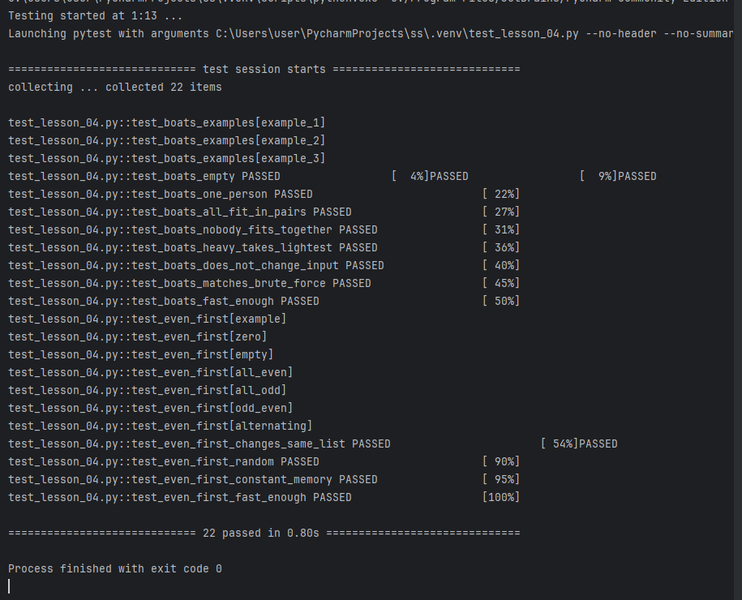
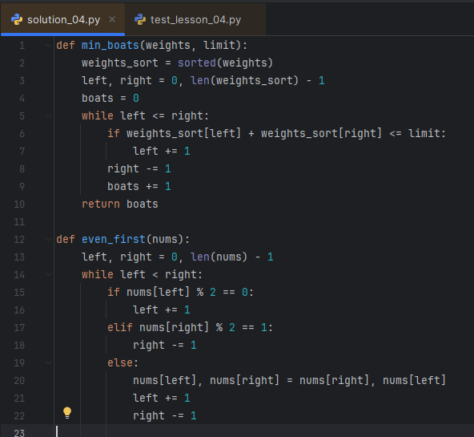

# Домашняя работа № 4 · Две задачи на изученные приёмы

**Дисциплина:** ОП.04 «Основы алгоритмизации и программирования»

| Поле | Значение |
|---|---|
| Фамилия, имя, отчество | Карпушова Лилия Дмитриевна |
| Группа | 9/3-РПО-24/2 |
| Номер работы | 4 |
| Тема работы | Лодки на сплаве и «сначала чётные»: выбор приёма |
| Ветка | `hw-04` |

---

## 1. Лодки на сплаве

Я отсортировала копию списка весов и решил задачу приёмом двух указателей навстречу.
Время решения — O(n log n), дополнительная память — O(n).

## 2. Сначала чётные

Я переставила числа внутри `nums` приёмом двух указателей навстречу, новых списков не создавала.
Время решения — O(n), дополнительная память — O(1).

---

## 3. Проверка

