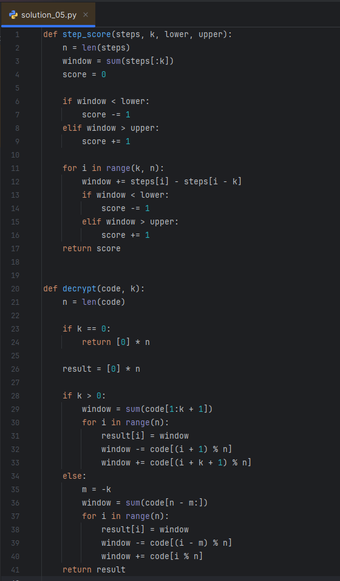
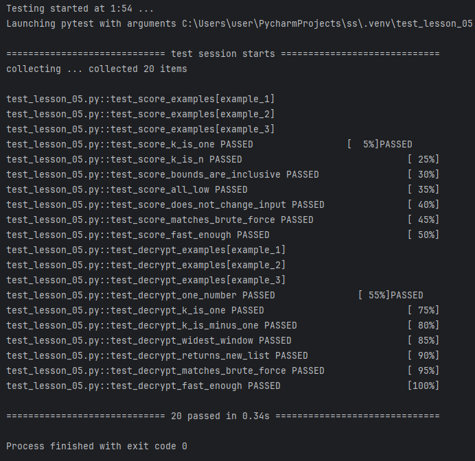

# Домашняя работа № 5 · Скользящее окно фиксированного размера

**Дисциплина:** ОП.04 «Основы алгоритмизации и программирования»

| Поле | Значение |
|---|---|
| Фамилия, имя, отчество | Карпушова Лилия Дмитриевна |
| Группа | 9/3-РПО-24/2 |
| Номер работы | 5 |
| Тема работы | Очки фитнес-браслета и кодовый замок: окно длины k |
| Ветка | `hw-05` |

---

## 1. Очки фитнес-браслета

Окно — k дней подряд, всего окон при длине списка n — `n - k + 1`.
При сдвиге окна я прибавляю пришедший день и вычитаю ушедший, поэтому
сумма каждого окна считается за O(1).
Время решения — O(n), дополнительная память — O(1).

## 2. Кодовый замок

При `k > 0` окно для позиции `i` — числа с номерами от `i + 1` до `i + k`,
при `k < 0` — от `i + k` до `i - 1` (по кругу, через остаток от деления).
Время решения — O(n), дополнительная память кроме ответа — O(1).

## 3. Проверка

