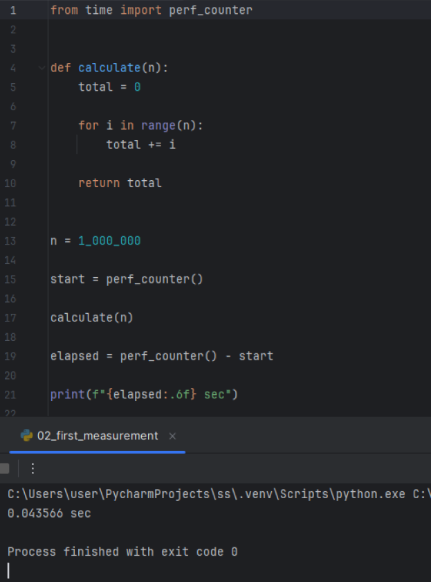
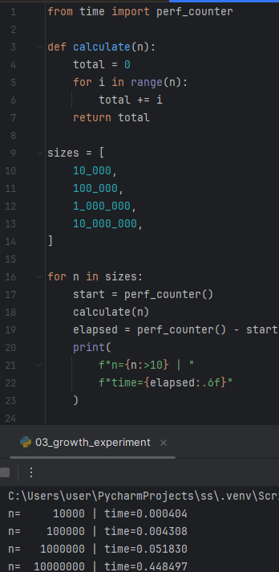
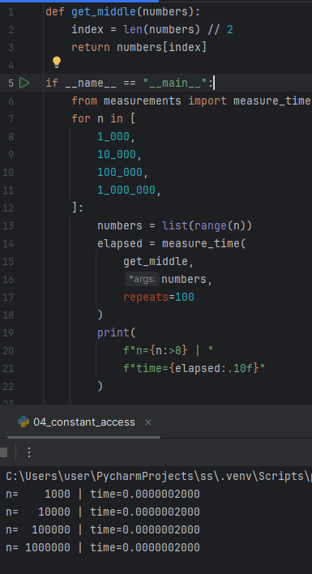
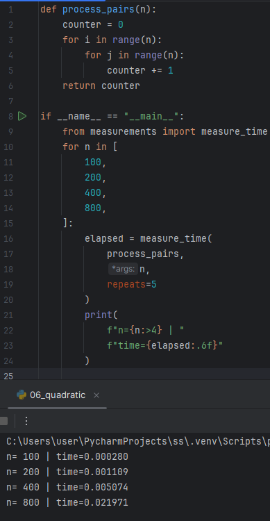
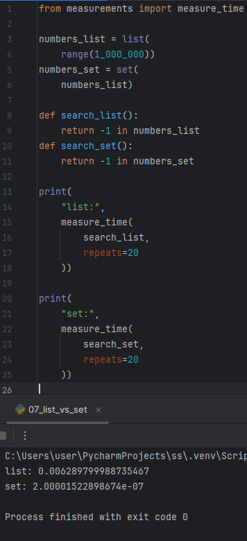
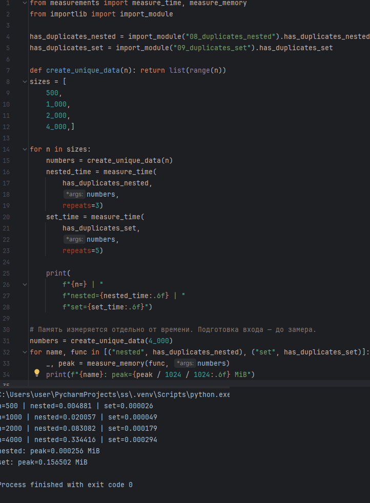
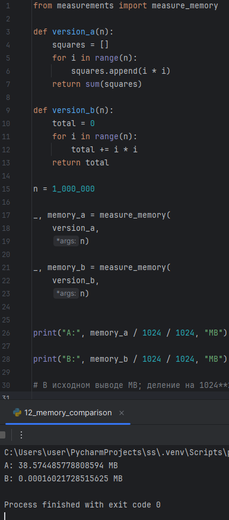

Ходкин 9/3-РПО-24/2

## Пример 1. 02_first_measurement.py
**Скриншот:**

**Что измерялось:** длительность суммирования всех целых чисел от 0 до 999 999 (всего 1 000 000 итераций).
**Результат:** 0.043566 секунд.
**Вывод:** операция сложения миллиона чисел выполняется за доли секунды, что подтверждает высокую скорость работы простых линейных циклов в Python.

## Пример 2. 03_growth_experiment.py
**Скриншот:**

**Что измерялось:** время суммирования для последовательностей чисел с шагом в 10 раз: 10 000, 100 000, 1 000 000 и 10 000 000.
**Результат:** 
- n=10 000: 0.000404 сек
- n=100 000: 0.004308 сек
- n=1 000 000: 0.051830 сек
- n=10 000 000: 0.448497 сек
**Вывод:** при увеличении размера входных данных в 10 раз время выполнения также возрастает примерно в 10 раз, что наглядно демонстрирует линейную сложность O(n).

## Пример 3. 04_constant_access.py
**Скриншот:**

**Что измерялось:** получение элемента из середины списка (по индексу `len // 2`) для списков разной длины.
**Результат:** для всех размеров (от 1 000 до 1 000 000) время составило 0.0000002000 секунд.
**Вывод:** время доступа к элементу по индексу не зависит от размера списка, что подтверждает константную сложность O(1).

## Пример 4. 05_linear_search.py
**Скриншот:**

**Что измерялось:** время поиска числа (-1) в списках разной длины, при условии, что числа в списке нет.
**Результат:** 
- n=10 000: 0.000182 сек
- n=100 000: 0.001881 сек
- n=1 000 000: 0.019006 сек
**Вывод:** поскольку искомый элемент отсутствует, алгоритм вынужден проверить весь список. Время растет линейно вместе с увеличением входных данных.

## Пример 5. 06_quadratic.py
**Скриншот:**

**Что измерялось:** время выполнения вложенных циклов (подсчет всех пар) для значений n = 100, 200, 400, 800.
**Результат:** 
- n=100: 0.000280 сек
- n=200: 0.001109 сек
- n=400: 0.005074 сек
- n=800: 0.021971 сек
**Вывод:** при увеличении n в 2 раза время растет примерно в 4 раза, что соответствует квадратичной сложности O(n^2).

## Пример 6. 07_list_vs_set.py
**Скриншот:**

**Что измерялось:** скорость проверки наличия элемента (-1) в списке и во множестве.
**Результат:** поиск в списке (list) — 0.006289 сек, поиск во множестве (set) — 0.00000215 сек.
**Вывод:** поиск во множестве работает в тысячи раз быстрее благодаря использованию хэш-таблицы (сложность O(1)), тогда как в списке происходит полный перебор (O(n)).

## Пример 7. 10_final_experiment.py
**Скриншот:**

**Что измерялось:** сравнение времени и пиковой памяти для поиска дубликатов двумя способами: вложенными циклами (`nested`) и через множество (`set`).
**Результат (время):** на n=4000 `nested` занял 0.334416 сек, а `set` — всего 0.000294 сек.
**Результат (память):** пик памяти для `nested` — 0.000256 MiB, для `set` — 0.156502 MiB.
**Вывод:** алгоритм с множеством работает значительно быстрее (O(n) против O(n^2)), но требует больше дополнительной памяти для хранения хэш-таблицы.

## Пример 8. 11_sum_comparison.py
**Скриншот:**

**Что измерялось:** сравнение времени ручного суммирования в цикле и использования встроенной функции `sum()`.
**Результат:** ручное суммирование — 0.032895 сек, встроенная функция — 0.023305 сек.
**Вывод:** встроенные функции Python оптимизированы на уровне C и работают быстрее, чем аналогичный код, написанный вручную на Python.

## Пример 9. 12_memory_comparison.py
**Скриншот:**

**Что измерялось:** объем памяти, затрачиваемый на создание списка квадратов чисел (версия А) и на вычисление суммы квадратов без сохранения списка (версия Б).
**Результат:** версия А (со списком) — 38.57 МБ, версия Б (без списка) — 0.00016 МБ.
**Вывод:** создание промежуточной структуры данных (списка) требует огромного количества памяти по сравнению с вычислением «на лету», где используются только переменные.

## Пример 10. 13_list_generator.py
**Скриншот:**

**Что измерялось:** время и память при суммировании квадратов через генератор списка и через ленивый генератор (generator expression).
**Результат:** время примерно одинаковое (около 0.1 сек на 1 000 000), но память отличается: список занимает до 38.57 МБ, а генератор — стабильно 0.000504 МБ.
**Вывод:** генераторы не хранят весь набор данных в памяти, а выдают значения по одному, что делает их крайне эффективными по потреблению памяти при сохранении той же скорости.

## Пример 11. 14_repeated_runs.py
**Скриншот:**

**Что измерялось:** время выполнения одной и той же функции (суммирование 1 000 000 чисел) 7 раз подряд, а затем вычисление медианы.
**Результат:** результаты замеров варьируются от 0.040417 до 0.049374 сек, медиана составила 0.040707 сек.
**Вывод:** из-за накладных расходов операционной системы и случайных колебаний один замер может быть неточным. Использование медианы из нескольких прогонов позволяет получить более объективную оценку времени работы алгоритма.
